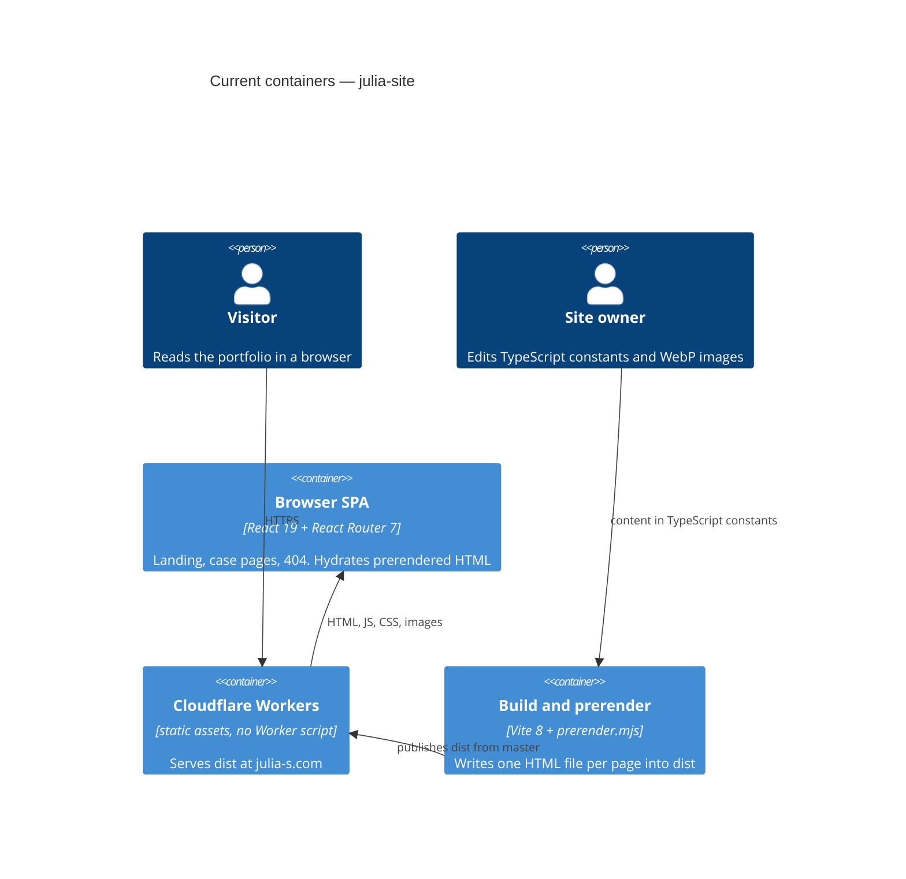

# Architecture map — julia-site

> The **current** architecture (what exists today), produced by `survey` and read by
> specify / design / data-model / implement. Refresh with `survey` when the repo drifts past
> `reflects_commit`. This is generated; a hand-maintained `docs/architecture.md`, if present, is
> authoritative and reconciled below — not replaced.

## Stack

- Language / runtime: TypeScript `~6.0.2` (`package.json:41`), `strict: true` + `noUncheckedIndexedAccess` (`tsconfig.app.json:20-21`), Node 22 (`.node-version:1`, `package.json:4-6`).
- Frameworks: React `^19.2.8` + `react-dom` (`package.json:24-25`), React Router `^7.18.4` (`package.json:26`), Vite `^8.3.5` (`package.json:42`), Sass `^1.105.1` (`package.json:39`). No backend runtime package.
- Build / test / lint: `npm run build` = `tsc -b && vite build && vite build --ssr src/entry-server.tsx --outDir dist/server && node scripts/prerender.mjs` (`package.json:11`); `npm test` = `vitest run` (`package.json:16`); `npm run lint` = `oxlint` (`package.json:12`); `npm run format:check` = Prettier (`package.json:15`). CI runs lint → format:check → test → build (`.github/workflows/deploy.yml:30-37`).

## C4 — system as it is

## Module inventory

Flat SPA. Layers are **page → component → constants/utils**, not hexagonal dirs. No `services/`, `api/`, or datastore module.

| Module | Path | Layers | Wired at | Responsibility |
|---|---|---|---|---|
| App / routes | `src/App.tsx`, `src/main.tsx`, `src/entry-server.tsx` | composition | `index.html` → `main.tsx:32`; SSR `entry-server.tsx:21-42` | Client hydrate vs createRoot; `AppRoutes` under `SiteShell` |
| Pages | `src/pages/` | page composition | `src/App.tsx:22-31` | `LandingPage`, lazy `ProjectCasePage`, `NotFoundPage` |
| Components | `src/components/` | UI | pages + `SiteShell.tsx:34-42` | Chrome (Header, Footer, SkipLink, Logo, SiteNav, Contacts), `ProjectCard`, `ProjectCase/*` |
| Constants | `src/constants/` | content data | pages / components / utils / vite | Projects, cases, `publishedProjectIds`, `caseCopy`, nav, contacts, site strings |
| Utils | `src/utils/` | pure helpers + 2 hooks | everywhere | SEO head, sitemap/robots, prerender list, IDs, URLs |
| Styles | `src/styles/` | design tokens | `src/index.scss:1-6` + component SCSS | Colors, typography, spacing, sizes, breakpoints, fonts |
| Vite plugins | `src/vite/` | build plugins | `vite.config.ts:11` | Dev head injection, sitemap/robots, preview HTML routes, HTTP 404 |
| Tests | `src/tests/` | Vitest | `vite.config.ts:12-16` | Mirrors `src/` (`pages/`, `components/`, `utils/`, `vite/`) |
| Scripts | `scripts/` | Node build-time | `package.json:11,18-21` | Prerender, image optimize, card variants, OG image |
| Public assets | `public/` | static files | copied into `dist` | Fonts, `projects/` WebP, `_headers`, `og.png`, favicons |
| Host config | `wrangler.jsonc` | deploy | Cloudflare dashboard from `master` | Worker name `julia-graphic-designer-portfolio`; assets from `./dist` |

## Conventions (cited — the rules a new feature must match)

- **Module wiring / registration:** `AppRoutes` nests every page under `SiteShell` (`src/App.tsx:22-31`). A published case is live only when `src/constants/cases/{id}.ts` is listed in `listProjectCases` (`src/constants/projectCases.ts:10-21`), the id is in `publishedProjectIds()` (`src/constants/publishedProjectIds.ts:5-7`), and a matching `caseCopy` row exists (`src/constants/caseCopy.ts:9-16`) because prerender walks `caseCopy` (`src/utils/prerenderPages.ts:97-100`). Case section types are registered only in `renderSection` (`src/components/ProjectCase/ProjectCase.tsx:52-102`).
- **Error handling:** No ErrorBoundary and no Result type. User-facing miss → `NotFoundPage` (`src/App.tsx:28`; unknown case id `src/pages/project/ProjectCasePage.tsx:25-27`). Build throws with a static message and `{ cause }` (`scripts/prerender.mjs:36-38`). Client logs and returns when `#root` is missing (`src/main.tsx:16-18`) or a request path will not decode (`src/utils/requestPathname.ts:10-14`).
- **IDs:** String slugs. Homepage card `Project.id` may differ from case URL slug; `project.caseId ?? project.id` (`src/utils/projectCaseId.ts:6-8`). Published URLs are `publishedProjectIds()` and must equal `listProjectCases().map(c => c.id)` (`src/tests/utils/indexablePaths.test.ts:10`). Route shape `/projects/:projectId` (`src/App.tsx:27`).
- **Persistence / DB access:** None. No `fetch`, no `localStorage`, no API client. Content is compile-time TypeScript constants (`src/constants/projects.ts`, `src/constants/cases/`, `src/constants/contacts.ts`). Only env read: `SITE_ORIGIN` (`src/utils/siteOrigin.ts:7-14`).
- **Migrations:** N/A — static prerender to `dist`; Wrangler serves assets only (`wrangler.jsonc:5-9`).
- **Tests:** Vitest + Testing Library, `environment: "jsdom"`, `setupFiles: "./src/tests/setup.ts"` (`vite.config.ts:12-16`; `src/tests/setup.ts:1`). Files live under `src/tests/<area>/` as `*.test.ts(x)`. Components: `render` + `screen` + `cleanup` (`src/tests/components/Footer/Footer.test.tsx:1-15`). Utils: `describe`/`it`/`expect` only. SSR tests use `// @vitest-environment node` (`src/tests/entry-server.test.ts`).
- **Inter-module communication:** Direct imports only. No React Context, no events. Shared runtime is React Router (`useParams` in `src/pages/project/ProjectCasePage.tsx:18`; `useMatch` in `src/components/SiteShell/SiteShell.tsx:17`). Data flows as props.
- **UI / styling (if a frontend exists):** In-repo Sass tokens + colocated `.scss` (except ProjectCase, which uses one barrel). Token `@use` order: colors → typography → spacing → sizes → breakpoints (`src/pages/home/LandingPage.scss:1-5`). No third-party component kit. Detail in §Frontend / UI foundation below.
- **Import order:** packages → components → pages → constants → utils → assets → `*.scss`, blank line between groups (`.cursor/rules/import-order.mdc`; lived `src/pages/home/LandingPage.tsx:1-13`).
- **File size:** source under 1000 lines; split by responsibility (`.cursor/rules/file-size.mdc:7-12`).
- **Images:** `public/projects/` is WebP, produced by `scripts/optimize-images.mjs` / `scripts/card-image-variants.mjs`. Image audit fails unused or missing files (`src/tests/utils/imageAudit.test.ts`).
- **TypeScript:** `strict` + `noUncheckedIndexedAccess` + `noUnusedLocals` + `verbatimModuleSyntax` (`tsconfig.app.json:14,20-25`). Oxlint `typescript/no-explicit-any: error` (`.oxlintrc.json:14`). `scripts/` is oxlint-ignored (`.oxlintrc.json:3`).

## Datastores

| Store | Engine | Accessed via | Notes |
|---|---|---|---|
| (none) | — | compile-time constants in `src/constants/` | Static site. Media files on disk under `public/projects/`. Canonical origin from `SITE_ORIGIN` / default `https://julia-s.com` (`src/utils/siteOrigin.ts:3-10`). |

## Frontend / UI foundation

- **Component library / design system:** In-repo only. No MUI, Radix, Tailwind, CSS Modules, or styled-components (`package.json:23-44`). Folders under `src/components/`: `Contacts`, `Footer`, `Header`, `Logo`, `ProjectCard`, `ProjectCase`, `SiteNav`, `SiteShell`, `SkipLink`. There is no shared `Button`, `Input`, `Card`, or `Modal` — buttons are native (`Header.tsx`, `Footer.tsx`); links are `<a>` or `react-router-dom` `Link` (`src/components/ProjectCard/ProjectCard.tsx:38`).
- **Design tokens:** Sass `$variables` in `src/styles/`: `_colors.scss` (surfaces, text, accent), `_typography.scss` (families, sizes, tracking, leading), `_spacing.scss` (scale + place-specific), `_sizes.scss` (page/card/case geometry), `_breakpoints.scss` (`$bp-desktop` 1440 through `$bp-phone` 479 plus `fluid()`), `_fonts.scss` (`@font-face` only). Rule: `.cursor/rules/scss-tokens.mdc`.
- **Styling approach:** Global Sass + per-file SCSS imported from TSX last. Not CSS Modules. Example: `src/pages/home/LandingPage.tsx:13` + `LandingPage.scss:1-5`. Global reset and skip-link styles in `src/index.scss`. ProjectCase exception: one barrel `src/components/ProjectCase/styles/ProjectCase.scss:1-16` `@use`s shared partials then per-case skins. Class names are global BEM-ish (`site-header`, `case-page`, `project-card`). Desktop-first `max-width` queries against `$bp-*`.
- **Shared primitives:** `SiteShell` (SkipLink + Header + `<Outlet />` + Footer, inverse chrome on published case URLs — `src/components/SiteShell/SiteShell.tsx:16-42`), `Header` / `SiteNav` / `Logo` / `Footer` / `Contacts` / `SkipLink` (`src/components/SkipLink/SkipLink.tsx:1-6` → `#main-content`), `ProjectCard` + `ProjectVisual`. Case sections: `CaseIntro`, `CaseMedia`/`CaseFrame`, `CaseComparison`, `CaseSplit`, `CasePalette`, `CaseMarks`, `CasePoster`, `CaseCluster`, `CasePair`, `CaseGrid`, `CaseStagger`, `CaseBanner`, `CaseNote`, `CaseLogoStack`, `CaseLogoPair`, `CaseWordmarkLogo`, `CaseIconBoard`, `CaseTypefaces`, `CaseRelated`.
- **State / data-fetching:** No Redux, Zustand, React Query, or Context. Local `useState` for the header menu. Router is the shared runtime. Data is static constants. Head tags via `useDocumentHead` / `usePageTitle` (DOM, not a store). Case route is `React.lazy` (`src/App.tsx:12-18`).
- **Closest UI precedent:** a new screen/component looks like `LandingPage` (`src/pages/home/LandingPage.tsx:26-73` — `<main id="main-content">`, hero, `ProjectCard` grids) or a case page (`src/pages/project/ProjectCasePage.tsx:36-39` → `src/components/ProjectCase/ProjectCase.tsx:42-48` — typed `CaseSection` union in `.case-flow`). Do not invent a second card or header. A new case type extends `CaseSection` (`src/constants/projectCase.ts:247-264`) and adds a `renderSection` arm.

## Where things live / closest precedents

- A new **published project case** → `src/constants/cases/{id}.ts`, register in `src/constants/projectCases.ts:10-17`, id in `src/constants/publishedProjectIds.ts:6`, share row in `src/constants/caseCopy.ts`, homepage card in `src/constants/projects.ts`, images under `public/projects/{id}/` as WebP, optional `case-page--{id}` modifier (`src/components/ProjectCase/ProjectCase.tsx:31-39`) + SCSS `@use` (`src/components/ProjectCase/styles/ProjectCase.scss:12-16`). Modelled on `lovespace`. Route `projects/:projectId` already exists (`src/App.tsx:27`). Sitemap follows `publishedProjectIds` (`src/vite/siteDiscovery.ts:28-30`); HTML files follow `caseCopy` (`src/utils/prerenderPages.ts:97-100`). Test lock: `src/tests/utils/indexablePaths.test.ts:10`.
- A new **top-level page** → `Route` in `src/App.tsx:22-31`, entry in `prerenderPages()` (`src/utils/prerenderPages.ts:83-116`), and `indexablePaths()` (`src/utils/indexablePaths.ts:4-8`) if crawlers should see it. `/404` is prerendered but not in the sitemap. Modelled on `LandingPage` (`src/pages/home/LandingPage.tsx:26-73`) for chrome + heading + grid.
- A new screen / UI component → composed from the existing design system (§Frontend), modelled on `LandingPage` (`src/pages/home/LandingPage.tsx:26-73`) or `ProjectCase` (`src/components/ProjectCase/ProjectCase.tsx:42-102`).
- A new **SEO/head/sitemap change** → `src/utils/siteHeadTags.ts`, `src/utils/prerenderPages.ts`, `src/vite/siteDiscovery.ts`, `src/vite/siteHead.ts` (dev only). Production HTML is filled by `scripts/prerender.mjs`.
- A new **image pipeline change** → `scripts/optimize-images.mjs`, `scripts/card-image-variants.mjs` (widths must match `CARD_VARIANT_WIDTHS` in `src/utils/cardSources.ts`), `scripts/render-og-image.mjs` → `public/og.png`.

## Constraints & known tech-debt

- Node 22 pin — `.node-version` is `22`; engines `>=22`; Node 20 cannot run the tests (`README.md`).
- Wrangler Worker name must stay `julia-graphic-designer-portfolio` (`wrangler.jsonc:3`). A different name fails the next deploy and leaves the live site unchanged.
- Vite `base` is `/` (`vite.config.ts:10`). Canonical URLs use `SITE_ORIGIN` with no trailing slash (`src/utils/siteOrigin.ts:3-10`); default `https://julia-s.com`.
- No Worker script (`wrangler.jsonc:5-9`). `public/_headers` is the only place for cache and security headers. Duplicate `Cache-Control` in one block is comma-joined (`public/_headers:1-6`). HTML under `/projects/` must not match the `/*.webp` rule (`public/_headers:26-28`).
- GitHub workflow **Verify** only lints, tests, and builds (`.github/workflows/deploy.yml:30-37`). It does not call Wrangler; Cloudflare publishes `dist` from `master` outside this YAML.
- Three ID lists must stay aligned: `publishedProjectIds`, `listProjectCases`, and `caseCopy` (prerender uses `caseCopy`, sitemap uses `publishedProjectIds`).
- No Button/Input/Modal kit — new chrome extends Header/Footer/native elements, not a new design system.
- Token drift: some case skins still use raw hex/px and ad-hoc breakpoints (800/700/360) instead of `$bp-*`. Inline brand colors from case data are intentional (`CasePalette`, `CasePoster`, `CaseBanner`).
- README drift vs code: README says `src/test/` (actual `src/tests/`); README says fonts and project images keep `max-age=0` (actual `/fonts/*` is one year and `/projects/*/*.webp` is one week — `public/_headers:22-28`).
- `scripts/` is oxlint-ignored (`.oxlintrc.json:3`).
- Comments in `navigation.ts` / `contacts.ts` mention a possible later CMS — not implemented.

## Reconciliation with the authored architecture doc

No `docs/architecture.md`. Hand-maintained sources reconciled:

- `AGENTS.md` matches this map: React 19 + TypeScript + Vite + Sass, prerender via `scripts/prerender.mjs`, Cloudflare Workers static assets, case files under `src/constants/cases/` + `src/components/ProjectCase/` + `src/pages/project/`, tokens in `src/styles/`, SEO in `src/utils/` + `src/vite/`, WebP under `public/projects/`. This file is the map `AGENTS.md` pointed at.
- `README.md` matches the stack, scripts, and deploy story, with the two drifts noted under Constraints (test folder name; cache headers). Project-structure tree in README is incomplete (omits `src/pages/project/`, `src/vite/`, `src/entry-server.tsx`).
- `.cursor/rules/*.mdc` (file-size, import-order, scss-tokens) are the coding conventions this map cites; they were not overwritten.
