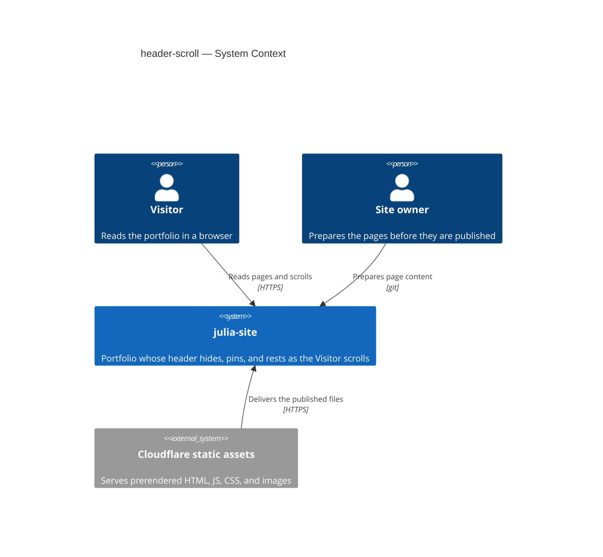
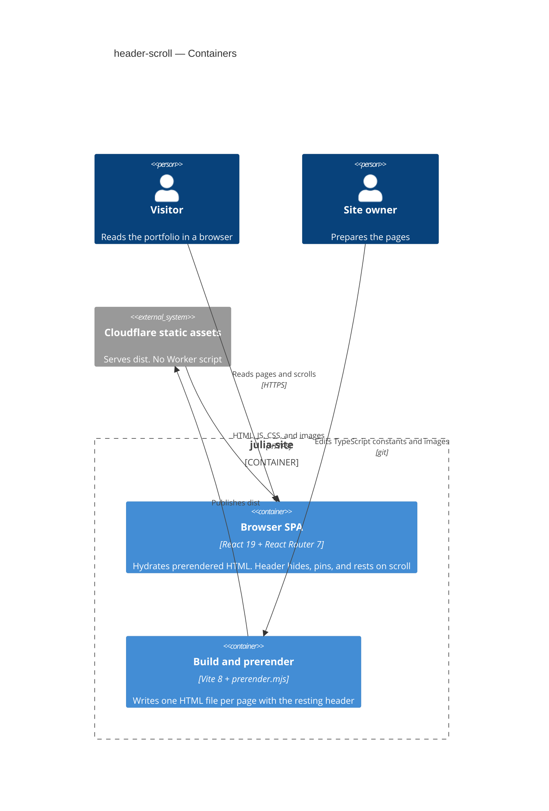
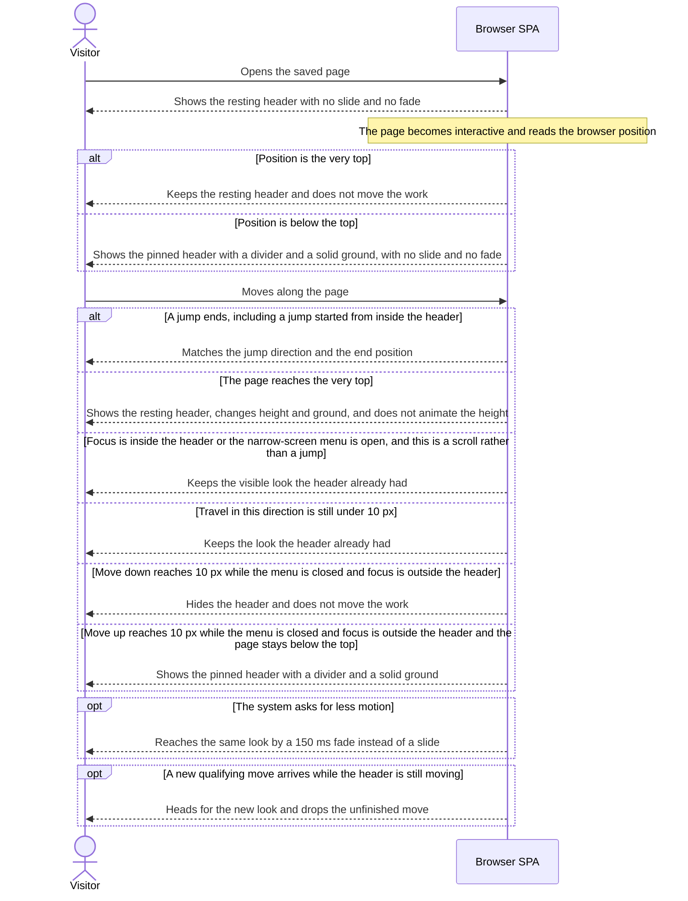

# Software Architecture Document — header-scroll

## 1. Introduction and goals

**Intent.** A Visitor reading a long page can move the header off the screen while traveling down, bring back the pinned header while traveling up, and see the resting header at the very top. The header keeps the opening tone the page's route declares, and hiding it, pinning it, or returning it to rest does not move the work. The people affected are Visitors of the portfolio, on every page that already shows this header.

**Top-3 quality goals (1-liners; full scenarios in §10):**

1. After a qualifying move the header is fully hidden, fully pinned, or fully resting within ≤ 300 ms, or by a 150 ms fade when the system asks for less motion.
2. The first correction after the saved view plays 0 ms of slide or fade, the height does not animate when the pinned header becomes the resting header, and the work does not move.
3. Opening-tone changes on one page stay at 0. The route declares the tone once.

**Stakeholders.**

| Role       | Interest                                                                                    | Sign-off owner? |
| ---------- | ------------------------------------------------------------------------------------------- | --------------- |
| Visitor    | Reads the portfolio and uses the header to move through the page                            | No              |
| Site owner | Prepares the pages. The written review and the design frame are the source of this behavior | No              |
| Tech Lead  | SAD approval                                                                                | Yes             |

## 2. Constraints

**Technical.**

- TypeScript `~6.0.2`, `strict` plus `noUncheckedIndexedAccess`. Node 22 (`.node-version`).
- React `^19.2.8`, React DOM `^19.2.8`, React Router `^7.18.4`, Vite `^8.3.5`, Sass `^1.105.1`.
- No datastore and no backend runtime. Content is compile-time TypeScript constants.
- The site is a flat SPA: page, then component, then constants/utils. `npm run build` prerenders one HTML file per page (`scripts/prerender.mjs`). The browser hydrates that HTML (`src/main.tsx`).
- The header today is in normal flow (`position: relative`), transparent, inside `.container`. `.site-shell` sets `overflow-x: clip`. There is no `position: fixed` in `src/**/*.scss`.
- No `fetch`, no React Context, no third-party component or animation kit. The header menu is local `useState`.
- Scrolling adds no request. The spec NFR "Requests added by scrolling" is 0.

**Organisational.**

- Effort budget: TBD by the Site owner.
- Deadline: TBD by the Site owner.
- The Site owner prepares content. Implementation stays inside the existing frontend.

**Conventions.**

- `.cursor/rules/file-size.mdc`, `.cursor/rules/import-order.mdc`, `.cursor/rules/scss-tokens.mdc`.
- Design tokens live in `src/styles/`. Component SCSS `@use`s them. Desktop-first `max-width` queries. No hardcoded one-off sizes for shared geometry.
- Tests are Vitest plus Testing Library under `src/tests/`. A pure CSS change does not get a test that asserts CSS values. A markup, logic, or accessibility change does.
- Modules talk by direct imports and props. `SiteShell` passes `tone` into `Header`.

**Regulatory / external.**

- Spec §6.1: the header is public. It touches no personal data. It adds no authentication or authorization. Security review is N/A.
- Abuse cases in that section: a Visitor who does not prepare the pages still sees the header. There is no draft to hide, no text field to inject, and no record created by scrolling, so there is nothing to rate-limit.

## 3. Context and scope

A Visitor keeps one header in view while reading. Today that bar never steps aside. This feature gives that same header three looks — resting, hidden, and pinned — from the direction of travel and the end position. The Site owner prepares the pages before they are published. No new outside service is introduced.

<!-- brownfield: docs/architecture-map.md reflects f4c1a8c, which is not an ancestor of HEAD 6f904e0. An explorer re-read Header, SiteShell, the hydrate path, and the size tokens. The claims this SAD uses still match that code. Run survey to refresh the map. -->

**External systems (in / out):**

| Actor or system          | Type              | Interaction                                                                                                    |
| ------------------------ | ----------------- | -------------------------------------------------------------------------------------------------------------- |
| Visitor                  | Person            | Reads pages, scrolls, follows in-page links, and uses the keyboard and the narrow-screen menu                  |
| Site owner               | Person            | Prepares page content and images before publish                                                                |
| Cloudflare static assets | System (external) | Serves the prerendered HTML, JS, CSS, and images over HTTPS. No Worker script. This feature adds no call to it |

No identity provider. The feature adds no third-party system. The host above is the existing deploy target, not a new integration.

**C4 Context (L1):**

The Visitor and the Site owner are the only people. julia-site is one system. Cloudflare only serves the files that system already publishes. Nothing else is called when the header hides, pins, or rests.



## 4. Solution strategy

**Top strategic choices (the seeds for ADRs):**

1. **Target surface is `web-frontend` only.** The Visitor reads pages in the browser. The spec NFR "Requests added by scrolling" is 0, and the repo has no backend. §5 draws one container for that surface. A backend, a worker, or a second app is out of scope. This stays inline: the alternatives are excluded by that NFR and by §2.

2. **Keep the existing hybrid delivery.** The saved first view shows the resting header (spec AC-12). After the page becomes interactive, the client applies the pinned header or the resting header to match the browser position and plays 0 ms of slide or fade (spec AC-13). A static build cannot know a restored scroll position, so the scroll phase is not server-rendered. This stays inline. It is the delivery the repo already has, and the spec already fixes both ends of it.

3. **Keep the scroll phase in Header.** `Header` listens to window scroll, holds the phase beside the menu state it already owns, and applies the look. A pure function next to `Header` owns the rules: travel in one direction adds up, a change of direction resets that sum, under 10 px the look stays, and the very top shows the resting header. `SiteShell` does not grow a phase prop. See ADR-0001. The rejected alternative was to own that phase in `SiteShell`, which already scrolls to the top on a navigation that has no hash.

4. **Fix the header to the viewport, and clip elsewhere.** The header is `position: fixed` against the viewport, with the same max-width and horizontal padding as `.container`, so the logo stays aligned. `overflow-x: clip` leaves `.site-shell`. A wrapper that starts after the header and includes the page outlet and the footer carries that clip, so the header is not inside a clipping box and the window stays the scrollport. There is no spacer equal to the header height. The page content starts at the top, underneath the bar. See ADR-0002. The rejected alternative was to render `Header` outside `.site-shell` and leave the clip where it is.

5. **Paint with CSS, tokens, and the route tone.** Show and hide use CSS transitions in the header styles. No animation library. When the system does not ask for less motion, the header is fully settled within ≤ 300 ms. When the system asks for less motion, the same look is a 150 ms fade, not a slide. A new qualifying move in the other direction replaces a transition that is still running. Focus entering a hidden header shows the pinned header at once, or by a 150 ms fade when the system asks for less motion. The pinned header's height is one token in `src/styles/_sizes.scss`. In-page targets set `scroll-margin-top` to that token (spec AC-11). The opening tone stays the `tone` prop `SiteShell` already passes from the route. Height, divider thickness, spacing, and colors come from the design frame, not from a later section's background.

Each later choice traces to one of these. None of §5–§8 contradicts them.

## 5. Building block view

The site stays a flat SPA. This feature extends modules that already exist. It does not add a layer, a store, or a route. `Header` owns the phase and the menu. A pure function beside it owns the direction rules, so those rules can be tested without the layout. `SiteShell` keeps routing, the tone prop, and the scroll-to-top on navigation. It also owns the clip wrapper, because the clip is what would otherwise trap a fixed header. Shared geometry stays in the size tokens. Landing and contacts anchors already set `scroll-margin-top`. They consume the new token instead of `16px` and `5.5rem`.

**Internal decomposition:**

```
src/components/Header/
├── Header.tsx                 menu state, window scroll, applies the phase to the DOM
├── headerScrollPhase.ts       pure next phase from direction, position, and holds
└── Header.scss                fixed bar, slide, fade, ground, divider
src/components/SiteShell/
├── SiteShell.tsx              skip link, Header, then a clip wrapper around outlet and footer
└── SiteShell.scss             overflow-x clip moves off .site-shell onto that wrapper
src/styles/_sizes.scss         pinned header height token
src/pages/home/LandingPage.scss
└── projects anchor            scroll-margin-top uses the pinned height token
src/components/Contacts/Contacts.scss
└── contacts anchor            scroll-margin-top uses the pinned height token
```

Source order stays skip link, then `Header`, then the page. The clip wrapper does not contain `Header`. The fixed header repeats `.container`'s max-width and horizontal padding so the marks line up with the column.

**C4 Container (L2):**

One surface, so one web container: the browser SPA. The build-and-prerender step is the existing container that writes the saved first view. It is not a second surface. There is no database.

The Visitor scrolls the browser SPA. The Site owner feeds the build. The build publishes to Cloudflare, and Cloudflare delivers the files to that SPA. The header is inside the SPA, not a separate deployable.



## 6. Runtime view

**Critical flow 1: Scroll phase on the browser SPA.** The saved page shows the resting header. When the page becomes interactive, the SPA corrects to the browser position with no motion. Later moves hide, pin, or rest the header. Holds, less motion, jumps, and a move that arrives mid-transition are branches of this same flow. The `sequences` stage maps every spec §5 acceptance criterion onto a flow, a branch, or an explicit N/A.



**Critical flow 2:** <!-- N/A: XS. The failure and hold branches sit inside flow 1. No async collaborator and no second actor. -->

## 7. Deployment view

<!-- N/A: reuses existing deployment unit, no infra change. The site stays Cloudflare Workers static assets from dist, with no Worker script, and the same prerender. -->

The header's first paint is the resting header already written into that HTML. No new replica, metric pipeline, or scaling threshold comes with this feature.

## 8. Crosscutting concepts

Repo defaults. Nothing here overrides §2.

| Concept                 | Convention                                                                                          | Where defined                        |
| ----------------------- | --------------------------------------------------------------------------------------------------- | ------------------------------------ |
| Logging                 | `console.error` and return when `#root` is missing. This feature adds no logger                     | `src/main.tsx`                       |
| Authentication          | None. Every Visitor sees the same header rules                                                      | spec §6.1                            |
| Error handling          | No ErrorBoundary. An unknown page is `NotFoundPage`. The scroll phase does not add an error channel | `src/App.tsx`, architecture map      |
| ID strategy             | Stable DOM ids `top`, `projects`, and `contacts`. The menu id comes from `useId`                    | `Header.tsx`, landing page, contacts |
| Internationalisation    | N/A, single language. Header chrome strings stay as they are                                        | —                                    |
| Observability           | No tracing product. The §10 timings are observed on the page                                        | spec §6                              |
| Events                  | None. Direct imports, props, and local state                                                        | architecture map                     |
| Caching / rate-limiting | N/A. Repeated scrolling creates no record and no request                                            | spec §6.1                            |

## 9. Architecture decisions

| #    | Title                           | Status   | Section |
| ---- | ------------------------------- | -------- | ------- |
| 0001 | Keep the scroll phase in Header | Accepted | §4      |
| 0002 | Fix the header to the viewport  | Accepted | §4      |

ADR files live under `docs/features/header-scroll/adr/`.

## 10. Quality requirements

Numbers below are copied from spec §6. They are not rounded and not replaced with a tighter target.

**QG-1. The header settles after a qualifying move**

- **When:** the Visitor moves down or up past 10 px, the narrow-screen menu is closed, and keyboard focus is not inside the header. A second case: keyboard focus enters a hidden header by Tab, by the skip link, or by programmatic focus.
- **Then:** when the system does not ask for less motion, the time from the latest move past 10 px until the header is fully hidden, fully pinned, or fully resting is ≤ 300 ms. A new qualifying move in the other direction starts this clock again. When the system asks for less motion, that same interval is a 150 ms fade, not a slide. Focus entering a hidden header shows the pinned header at once, or by a 150 ms fade when the system asks for less motion. This reveal does not use the scroll slide.
- **How verify:** on the page, measure from the qualifying move, or from focus entering the header, until the header is fully in the target look. A Vitest test of `headerScrollPhase` asserts which motion mode applies (slide, 150 ms fade, at once, or none). It does not assert a CSS pixel value.

**QG-2. The work stays put**

- **When:** the saved view showed the resting header and the page becomes interactive, either at the very top or already below the top. And, separately, the pinned header becomes the resting header because the page reached the very top.
- **Then:** the first correction is 0 ms of slide or fade, and the page content does not move. When the pinned header becomes the resting header, the height and the ground change together, the height does not animate, and the page content does not move. Hiding the header or bringing the pinned header back also does not move the work.
- **How verify:** render the saved resting header, apply a browser position below the top, and confirm the pinned look appears with no slide and no fade and the content box does not shift. Repeat at scroll position 0 and confirm the resting header remains. From the pinned header, reach the top and confirm the height change is not animated and the content box does not shift.

**QG-3. The opening tone stays the one the route declared**

- **When:** the Visitor moves into a later section whose background is the opposite tone, including more projects, contacts, or the footer, on either a light or a dark opening tone.
- **Then:** opening-tone changes on that page are 0. The header keeps the marks of the declared opening tone, the pinned header keeps that tone's solid ground, and the divider keeps the contrasting tone.
- **How verify:** render the header at the tone the route declares, then change the surrounding section background. The tone prop and the mark, ground, and divider treatment stay the ones from the first paint. Count of tone changes is 0.

The movement threshold used above is the spec §6 row "Movement ignored": < 10 px in one direction. Travel in one direction adds up, and a change of direction resets that sum. The very top still shows the resting header when the movement that got there is shorter than 10 px.

## 11. Risks and technical debt

| Risk / debt                                                              | Severity | Mitigation                                                                                                                                                      | Owner      |
| ------------------------------------------------------------------------ | -------- | --------------------------------------------------------------------------------------------------------------------------------------------------------------- | ---------- |
| Effort budget and deadline are not in the spec                           | Low      | The Site owner sets both before `tasks`. No architecture choice waits on them                                                                                   | Site owner |
| The clip wrapper can miss a wide page that `.site-shell` clips today     | Low      | The wrapper includes the page outlet and the footer. Check a wide case page for a horizontal scrollbar before ship                                              | Tech Lead  |
| Anchor offsets disagree today: projects use 16px and contacts use 5.5rem | Low      | Both become `scroll-margin-top` of the pinned-height token when the feature is built. Until that edit, in-page targets are not yet cleared by the pinned header | Tech Lead  |

**Accepted debt (acceptable in v1, plan to fix later):**

- `docs/architecture-map.md` still records `reflects_commit` `f4c1a8c`, which is not an ancestor of HEAD `6f904e0`. This SAD does not rewrite the map. Run `survey` when the map should catch up. The header, shell, hydrate path, and tokens used here were re-read against HEAD.

No open architectural decision was deferred. Spec §8 has no open questions.

## 12. Glossary

Terms marked "in CONTEXT" are copied from the project or feature glossary. The two terms marked "not in CONTEXT yet" showed up in this design. Add them with `/sdd:glossary header-scroll` before the wording drifts.

| Term             | Meaning                                                                                                                                                                                                                                |
| ---------------- | -------------------------------------------------------------------------------------------------------------------------------------------------------------------------------------------------------------------------------------- |
| Visitor          | A person who reads the portfolio in a browser. Not the Site owner, who prepares the pages. In CONTEXT.                                                                                                                                 |
| Site owner       | The person who prepares the pages. Not a Visitor. In CONTEXT.                                                                                                                                                                          |
| Divider          | The bottom line of the pinned header that separates it from the page content, shown only with the pinned header. Not a separator between page sections, and not a line under the resting header. In CONTEXT.                           |
| Hidden header    | The header is off-screen after 10 px of travel downward, added up in that direction, while the page is below the top. Not the resting header and not the pinned header. In CONTEXT.                                                    |
| Opening tone     | The dark or light pair a page declares once for its header, passed in from that page's route, and kept for the whole page. Not the background of a later section, and not a color read from the pixels on screen. In CONTEXT.          |
| Pinned header    | The shorter header with a bottom divider and a solid ground in the page's opening tone, shown after an upward move while the page is below the top, and when the page opens already below the top. Not the resting header. In CONTEXT. |
| Resting header   | The taller header with no bottom divider and no solid ground, shown when the page is at the very top, including a page that does not scroll and the saved first view of a page. Not the pinned header. In CONTEXT.                     |
| Scroll phase     | The header look the pure function returns: resting, hidden, or pinned, plus whether the change slides, fades, snaps with no motion, or stays. Not in CONTEXT yet.                                                                      |
| First correction | The moment the page becomes interactive and the client applies the browser position to the header without a slide or a fade. Not in CONTEXT yet.                                                                                       |
