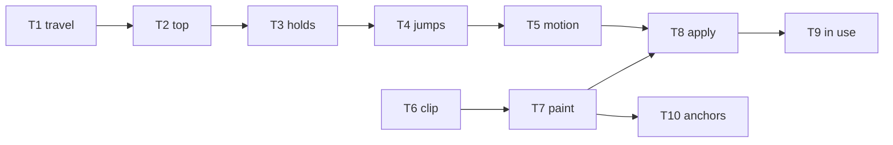

# Epic — header-scroll

> **Spec:** [spec.md](../spec.md) · **Design:** [sad.md](../sad.md) · **Screens:** [screens.md](../screens.md) · **ADRs:** [adr/](../adr/)
>
> No data model and no API contract. Scrolling adds no request, and the feature has no schema.

## Goal

A visitor can move the header off a long page, bring the shorter pinned header back, and see the taller resting header at the very top. The bar keeps the opening tone the route already declares, and hiding it, pinning it, or returning it to rest does not move the work. Size XS, route quick.

## Scope

- **In:** the pure scroll phase next to `Header`, the fixed bar and its three looks, the clip wrapper on `SiteShell`, the pinned-height token, and the existing projects and contacts anchors.
- **Out:** recoloring the header from a later section, a slide for a visitor who asked for less motion, a hidden header on arrival below the top, a hidden header when focus enters it, an animated height at the top, a solid ground on the resting header, and any change to the logo, the primary links, or how the narrow-screen menu opens and closes.

## Task map

T1 and T6 start together. The phase file is one lane (T1 through T5). The shell and header styles are the other (T6, then T7). T10 leaves that style lane as soon as the token exists and runs beside the rest. T8 waits for both the function and the classes. T9 extends T8.

## Tasks

See [tracker.md](./tracker.md) for status. Machine contract: [tasks.json](../tasks.json).

| #   | Task                                                | Layer  | Blocked by | DoD (short)                                      |
| --- | --------------------------------------------------- | ------ | ---------- | ------------------------------------------------ |
| T1  | Decide hide and pin from scroll travel              | domain | —          | Unit tests for hide, pin, and a short run        |
| T2  | Rest the header when the page is at the top         | domain | T1         | Unit tests for resting at position 0             |
| T3  | Hold the phase and reveal a hidden header on focus  | domain | T2         | Unit tests for hold, release, and focus reveal   |
| T4  | Match jumps and replace an unfinished move          | domain | T3         | Unit tests for jump endings and a reverse        |
| T5  | Choose slide, fade, or no motion                    | domain | T4         | Unit tests for fade and the first correction     |
| T6  | Fix the header to the viewport and move the clip    | ui     | —          | Shell test: header sits outside the clip wrapper |
| T7  | Paint resting, pinned, and hidden looks             | ui     | T6         | Phase classes and the pinned-height token exist  |
| T8  | Apply the scroll phase when the page is interactive | ui     | T5, T7     | Header test for scroll and the first correction  |
| T9  | Keep the header on screen while it is in use        | ui     | T8         | Header test for hold, release, and focus reveal  |
| T10 | Offset in-page targets by the pinned header height  | ui     | T7         | Both anchors use the pinned-height token         |

## Risks / Hard rules

- The phase stays in `Header`. `SiteShell` does not grow a phase prop, and there is no new store. — `adr/0001-keep-scroll-phase-in-header.md, Decision outcome, abridged`
- The header is fixed, the clip moves to a wrapper around the outlet and the footer, and there is no spacer. The page starts under the bar. — `adr/0002-fix-the-header-to-the-viewport.md, Decision outcome, abridged`
- Show and hide are CSS only. A qualifying move settles within 300 ms, or by a 150 ms fade when the system asks for less motion. The first correction plays neither. Height does not animate when pinned becomes resting. — `spec.md §6, abridged`
- Scrolling adds no request. The opening tone does not change on the page. — `spec.md §6, abridged`
- The clip wrapper has to include the outlet and the footer, or a wide case page loses the clip `.site-shell` has today. — `sad.md §11, Risks, abridged`
