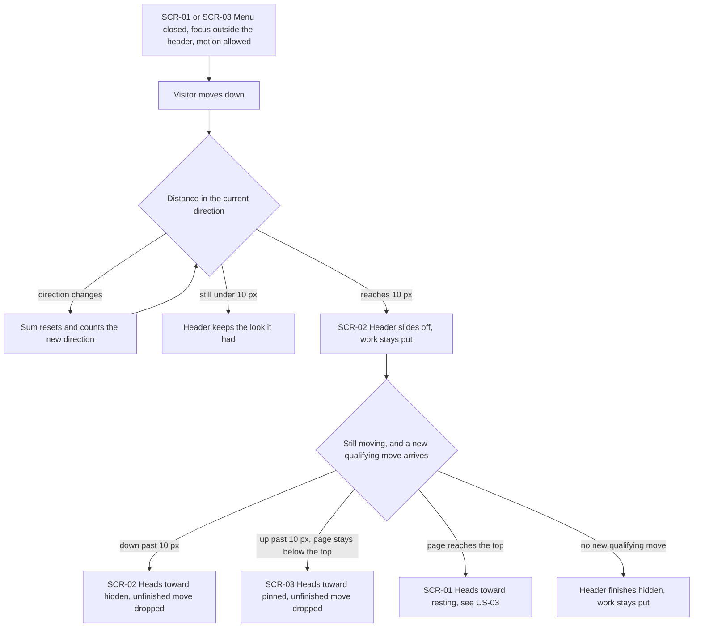
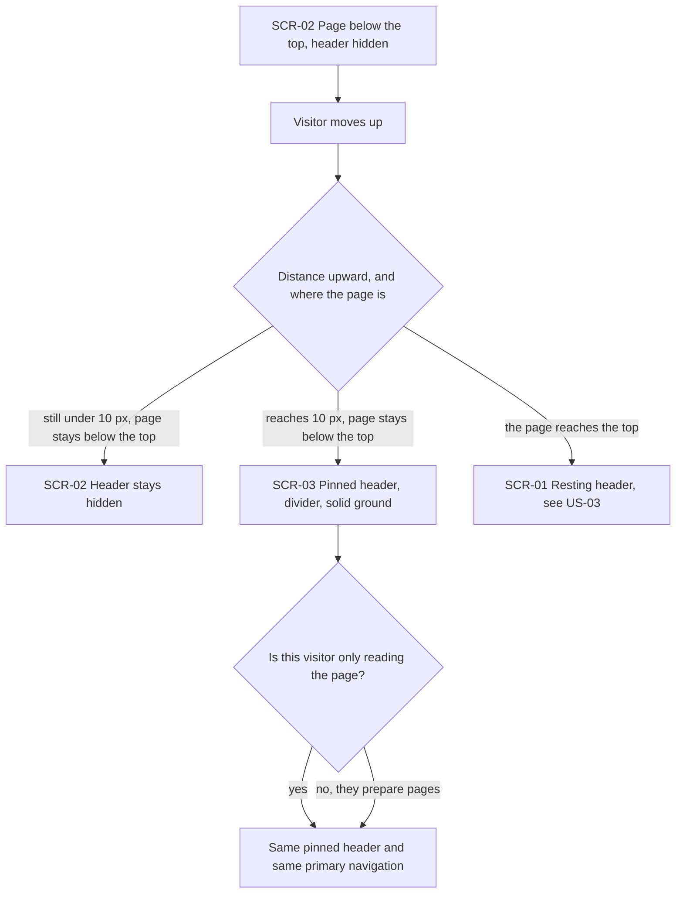
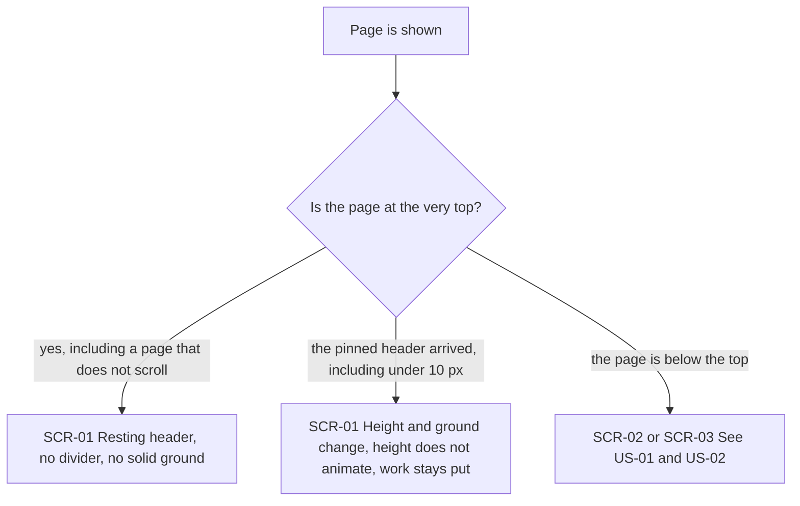
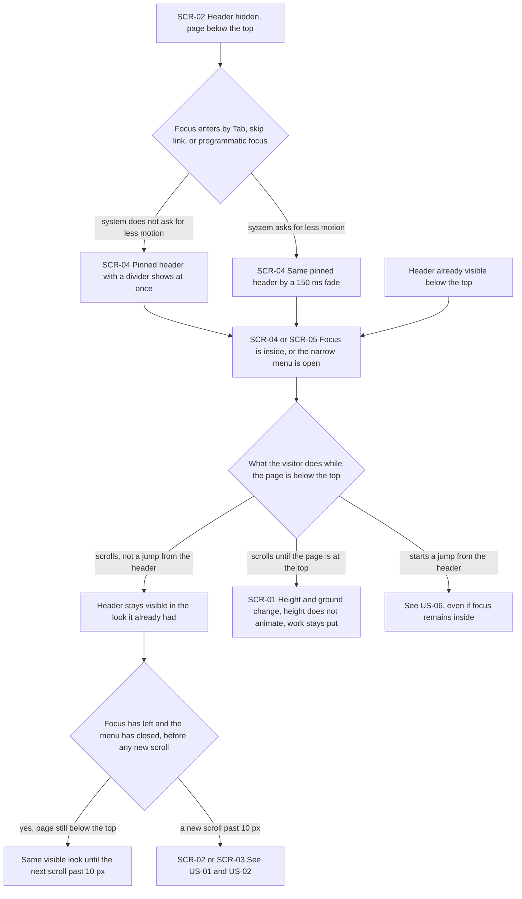
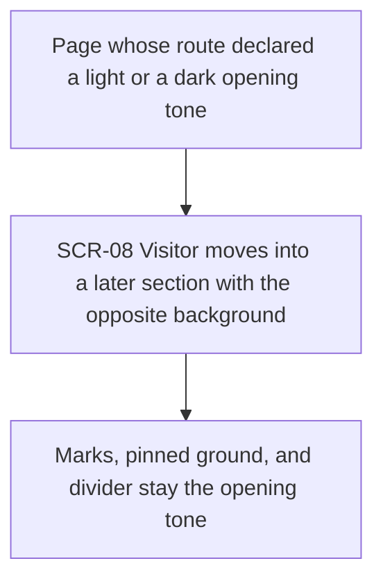
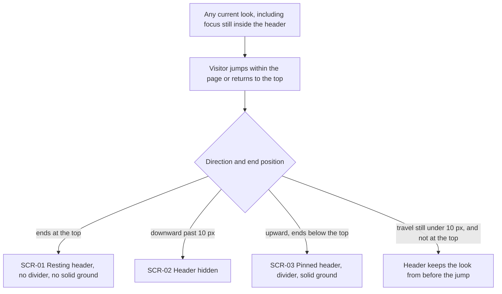
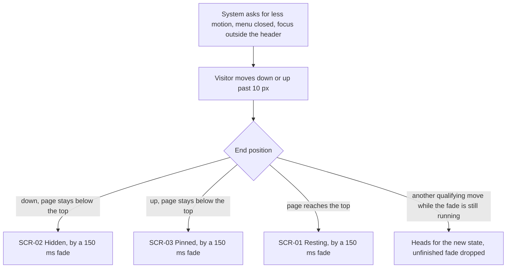
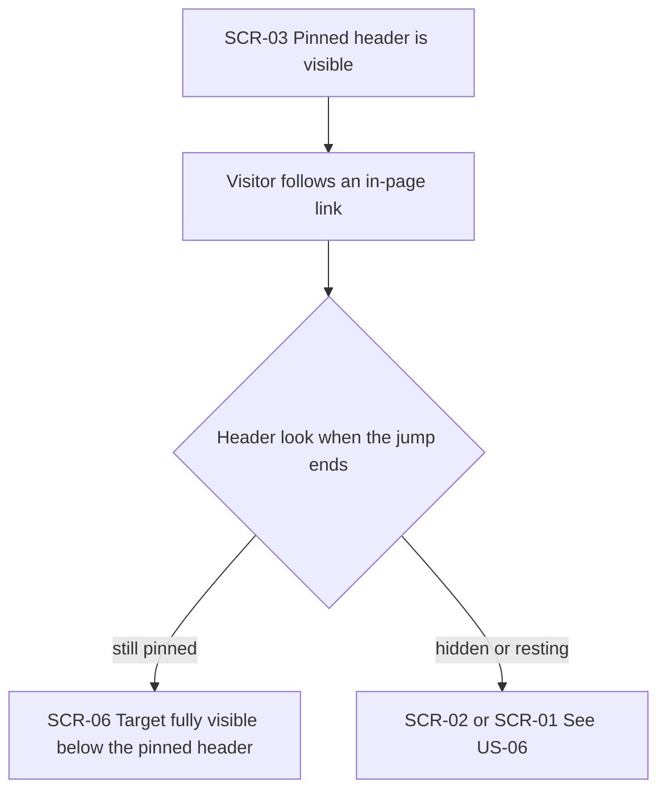
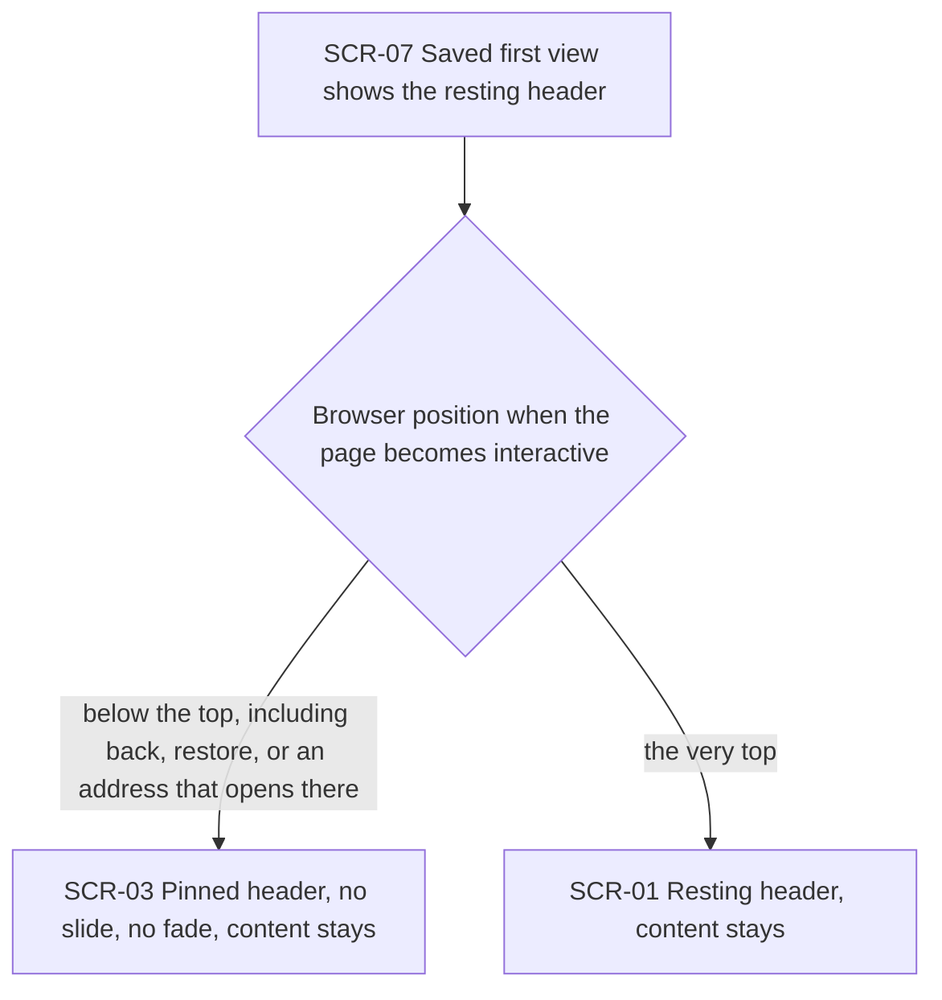

# UX flows — header-scroll

> User flows for every UI-touching §4 user story, produced by `ux-flows` (after `clarify`, before
> `design`) and read by `design` (evidence for the target-surface + UI-architecture decisions),
> `sequences` (UI-driven flows align on SCR ids), `screens` (details every inventory row) and
> `plan-tests` (the e2e-through-UI paths). **Always markdown + mermaid `flowchart`**, whatever the
> design tool — this artifact is flow-altitude, not visual design.

## Platform decisions

- **Posture:** desktop-first — per `docs/design-system.md`. No deviation. The narrow-screen menu hold is a specified behavior on the same page, not a second posture and not a phone-first layout.
- The header is chrome on the page the visitor is already reading. These flows do not add a route, a dialog, or a wizard.
- Show, hide, pin, and rest are states of that same page. Reaching one does not move the work.
- Flagged for `design`, not decided here: how the slide and the 150 ms fade are built, how the in-page target is offset by the pinned header's height, and how the first correction after the saved view applies with no motion. The visitor-visible results are already fixed by the spec.

## Screen inventory

| ID     | Screen                                | Purpose                                                                                                                                                    | Entry                                                                                                                                                                            | Exit                                                                                                                               |
| ------ | ------------------------------------- | ---------------------------------------------------------------------------------------------------------------------------------------------------------- | -------------------------------------------------------------------------------------------------------------------------------------------------------------------------------- | ---------------------------------------------------------------------------------------------------------------------------------- |
| SCR-01 | Page at the top                       | Taller resting header, no divider, no solid ground, including a page that does not scroll                                                                  | Open at the top, return to the top, or a move that arrives at the top. Arrival from the pinned header changes height and ground with no height animation, and the work stays put | Down past 10 px to SCR-02, or stay while the page does not scroll                                                                  |
| SCR-02 | Page below the top, header hidden     | Header off screen so the work is not covered                                                                                                               | Down past 10 px from SCR-01 or SCR-03, or a downward jump past 10 px                                                                                                             | Up past 10 px to SCR-03, on to the top at SCR-01, or keyboard focus entering the header to SCR-04                                  |
| SCR-03 | Page below the top, header pinned     | Shorter header with a divider and a solid ground in the page's opening tone                                                                                | Up past 10 px while still below the top, an upward jump that ends below the top, or arrival already below the top                                                                | Down past 10 px to SCR-02, or to the top at SCR-01, where height and ground change with no height animation and the work stays put |
| SCR-04 | Page with focus held in the header    | Keyboard focus inside the header. A visible header keeps the look it already had. Focus that enters a hidden header shows the pinned header with a divider | Tab, the skip link, or programmatic focus. From a hidden header this entry shows the pinned header at once, or by a 150 ms fade when the system asks for less motion             | Focus leaves, a jump started from the header, or the page reaches the top                                                          |
| SCR-05 | Page with the narrow-screen menu open | Header stays on screen in the look it already had while that menu is open                                                                                  | Visitor opens the narrow-screen menu                                                                                                                                             | Menu closes, or the page reaches the top                                                                                           |
| SCR-06 | In-page target under a pinned header  | The place an in-page link lands, fully visible below the pinned header                                                                                     | In-page link while SCR-03 is visible and the jump ends still pinned                                                                                                              | Further scroll uses SCR-02, SCR-03, or SCR-01                                                                                      |
| SCR-07 | Saved first view                      | Prepared page before any browser has a scroll position; resting header                                                                                     | The saved page is shown                                                                                                                                                          | The page becomes interactive and resolves to SCR-01 or SCR-03                                                                      |
| SCR-08 | Later section                         | A section farther down the same page whose background may be the opposite tone                                                                             | Visitor moves into that section                                                                                                                                                  | Header marks, pinned ground, and divider stay the opening tone on SCR-01, SCR-02, or SCR-03                                        |

## Flows

No §4 user story is backend-only. US-01 through US-09 all touch the header the visitor sees, so each has a flow.

### Flow: US-01 — Hide while moving down

Start: the page can scroll, the narrow-screen menu is closed, keyboard focus is outside the header, and the system does not ask for less motion. The visitor sees the resting header on SCR-01 or the pinned header on SCR-03. Action: the visitor moves down. End: travel in one direction adds up, and a change of direction resets that sum. Under 10 px, the header stays in the look it had, on SCR-01 or SCR-03. At 10 px the header slides off to SCR-02 and the work does not move. If a new move past 10 px the other way arrives while the header is still moving, it heads for hidden, pinned, or resting to match that new direction and end position, and it does not finish the move it had started. The same retarget applies when the header was moving toward pinned or resting. The very top still ends on the resting header. When that end replaces a pinned header, the height and the ground change with no height animation, and the work stays put, as in US-03.

### Flow: US-02 — Bring the pinned header back

Start: the page is below the top and the header is hidden on SCR-02. The menu is closed, focus is outside the header, and the system does not ask for less motion. Action: the visitor moves up. End: under 10 px, while the page stays below the top, the header stays hidden. At 10 px, still below the top, the visitor sees the pinned header on SCR-03, with a divider and a solid ground in that page's opening tone, and the work does not move. A visitor who only reads the page sees that same pinned header and the same primary navigation as any other visitor. If the upward move reaches the very top, the end state is the resting header on SCR-01, including when the last bit of travel is shorter than 10 px. When the header was pinned before that arrival, the height and the ground change with no height animation, and the work stays put, as in US-03.

### Flow: US-03 — Rest at the top

Start: a page is shown. One start is already the resting header, including a page that does not scroll. The other start is the pinned header on SCR-03, shorter, with a divider and a solid ground. Action: the page is at the very top, including when a move shorter than 10 px is what brought it there. End: the visitor sees the resting header on SCR-01, with no divider and no solid ground, so the page shows through. The top overrides the 10 px rule. When this end replaces the pinned header, the bar becomes the taller resting height and loses its solid ground. That height change is not animated. The work stays where it was. Below the top, this flow does not apply: the header is hidden or pinned.

### Flow: US-04 — Stay while in use

Start: either the header is hidden on SCR-02, below the top, or it is already visible below the top with keyboard focus inside it on SCR-04 or with the narrow-screen menu open on SCR-05. Action, from hidden: keyboard focus enters the header by Tab, by the skip link, or by programmatic focus. End of that entry: the header shows as the pinned header with a divider and a solid ground in the page's opening tone, and the visitor is on SCR-04. When the system does not ask for less motion, that pinned header shows at once. When the system asks for less motion, the same pinned header appears by a fade of 150 ms. Action, once focus is inside or the menu is open: the visitor scrolls, and this is a scroll rather than a jump started from the header. End: the header stays visible in the look it already had. That scroll does not hide it and does not switch its look. If that scroll reaches the very top, the pinned header becomes the resting header on SCR-01: the height and the ground change, the height does not animate, and the work stays put. A jump started from the header does not use this hold: it follows US-06 even when focus is still inside the header. When focus has left and the menu is closed, at that moment and before any new scroll, the header keeps the same visible look while the page stays below the top. The next scroll past 10 px is what changes it.

### Flow: US-05 — Keep the opening tone

Start: the visitor is on a page whose route declared one opening tone, light or dark, as in the spec table. Action: the visitor moves into a later section whose background is the opposite tone, including more projects, contacts, or the footer. End: on SCR-08 the header keeps the marks of the declared opening tone, the pinned header keeps that tone's solid ground, and the divider keeps the contrasting tone. The header does not take the later section's background.

### Flow: US-06 — Jumps match the move

Start: the header is in whatever look it had, and the jump may start from inside the header while focus stays there. Action: the visitor jumps within the page or returns to the top. End: an ending at the top shows the resting header on SCR-01, with no divider and no solid ground. When that ending replaces a pinned header, the height and the ground change with no height animation, and the work stays put, as in US-03. A downward jump past 10 px hides the header on SCR-02. An upward jump that ends below the top shows the pinned header on SCR-03, with a divider and a solid ground. A jump whose travel in that direction is still under 10 px, and which does not reach the top, leaves the header in the look it had before the jump. Focus still inside the header does not block these endings.

### Flow: US-07 — Less motion fades

Start: the visitor's system asks for less motion, the narrow-screen menu is closed, and keyboard focus is outside the header. Action: the visitor moves down or up past 10 px. End: the header reaches the same hidden, pinned, or resting result as it would for any other visitor, on SCR-02, SCR-03, or SCR-01, and it gets there by a fade of 150 ms rather than a slide. When that resting result replaces a pinned header, the height still does not animate. The fade is the change of look, not an animation of the height, and the work stays put. A new move past 10 px the other way, while that fade is still running, sends the header toward the new state and does not finish the fade it had started. While focus is inside the header or the narrow-screen menu is open, US-04 applies instead, and this fade does not hide the header.

### Flow: US-08 — Anchors stay clear

Start: the pinned header is visible on SCR-03. Action: the visitor follows an in-page link to a target on the same page. End: when the jump ends with the pinned header still visible, the target on SCR-06 is fully visible below that bar, offset by the pinned header's height, so the bar does not cover it. When the jump ends hidden or at the top, the header look comes from US-06, and this offset is not the thing keeping a pinned bar off the target.

### Flow: US-09 — Open below the top

Start: the saved first view is shown on SCR-07, before any browser has a scroll position, and the visitor sees the resting header, with no divider and no solid ground. Action: the page becomes interactive and the browser's position is applied. End: if that position is already below the top, including a restored place, the back control, or an address that opens below the first screen, the visitor sees the pinned header on SCR-03, with a divider and a solid ground. The page content stays where it was, and the header does not play the slide or the fade. If that position is the very top, the visitor still sees the resting header on SCR-01, and the page content does not move.

## AC coverage

| AC    | Shown by                                                       | Notes                                                                                                                                                                                                  |
| ----- | -------------------------------------------------------------- | ------------------------------------------------------------------------------------------------------------------------------------------------------------------------------------------------------ |
| AC-01 | Flow US-01 → reaches 10 px → SCR-02                            | Slide off when motion is allowed. The hold in US-04 and the fade in US-07 are separate givens.                                                                                                         |
| AC-02 | Flow US-02 → reaches 10 px → SCR-03                            | Pinned header, divider, and solid ground while the page stays below the top.                                                                                                                           |
| AC-03 | Flow US-03 → at the top → SCR-01                               | Includes a page that does not scroll.                                                                                                                                                                  |
| AC-04 | Flow US-04 → scrolls → header stays in the look it already had | Scroll only. A jump started from the header is US-06.                                                                                                                                                  |
| AC-05 | Flow US-06 → three end positions                               | Top, downward past 10 px, upward ending below the top. Focus still inside the header does not change the ending.                                                                                       |
| AC-06 | Flow US-01 → still under 10 px, and the direction-change reset | Also the under-10 px branches on US-02 and US-06. The top is not this branch.                                                                                                                          |
| AC-07 | Flow US-02 → reader → same pinned header                       | A visitor who only reads is not withheld a different header.                                                                                                                                           |
| AC-08 | Flow US-03 → pinned header arrived → SCR-01                    | The top overrides the 10 px rule. Height and ground change with no height animation. Also the top exits on US-01, US-02, and US-04.                                                                    |
| AC-09 | Flow US-05 → SCR-08 → opening tone kept                        | Light and dark declared tones. Later sections do not restyle the bar.                                                                                                                                  |
| AC-10 | Flow US-07 → 150 ms fade to SCR-02, SCR-03, or SCR-01          | Same end states as a visitor without that setting.                                                                                                                                                     |
| AC-11 | Flow US-08 → still pinned → SCR-06                             | Target offset by the pinned header's height. Other landings follow US-06.                                                                                                                              |
| AC-12 | Flow US-09 → SCR-07                                            | Saved view, before a browser position exists.                                                                                                                                                          |
| AC-13 | Flow US-09 → below the top → SCR-03                            | Back, restore, or an address that opens below the top. No slide, no fade, content stays.                                                                                                               |
| AC-14 | Flow US-09 → the very top → SCR-01                             | Interactive at the top keeps the resting header. Content stays.                                                                                                                                        |
| AC-15 | Flow US-04 → both holds end → same visible look                | Until the next scroll past 10 px. The page is still below the top.                                                                                                                                     |
| AC-16 | Flow US-01 → still moving → unfinished move dropped            | Also the retarget branch on US-07 while a fade is running.                                                                                                                                             |
| AC-17 | Flow US-01 settled, Flow US-02 pin, Flow US-03 snap            | Hiding, pinning, and returning to rest do not move the work. Pinned to resting changes height and ground with no height animation. Repeated on US-04 at the top and on US-09 for the first correction. |
| AC-18 | Flow US-04 → focus enters SCR-02 → SCR-04                      | Tab, skip link, or programmatic focus. Pinned header at once, or a 150 ms fade when the system asks for less motion.                                                                                   |
